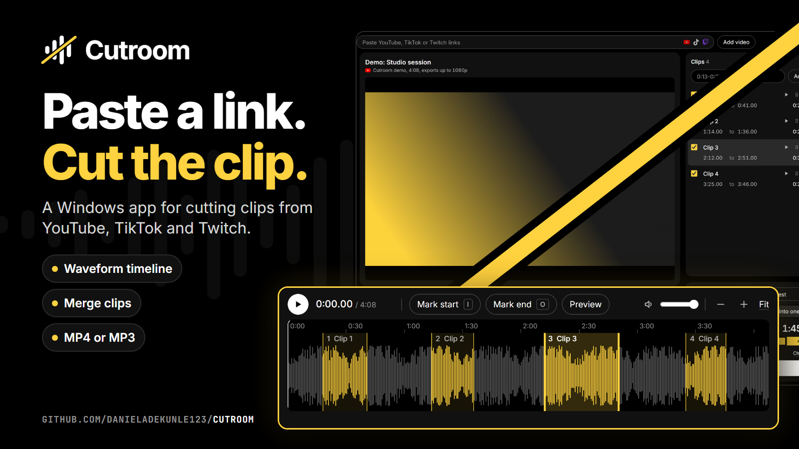

<p align="center">
  
</p>

<p align="center">
  <a href="https://github.com/danieladekunle123/cutroom/releases/latest"></a>
  <a href="https://github.com/danieladekunle123/cutroom/releases/latest"></a>
</p>

<p align="center">
  
  
  
</p>

## What it does

<table>
  <tr>
    <td width="33%" valign="top"><b>Cut on the waveform</b><br>Drag across the sound to mark a clip, or tap <kbd>I</kbd> and <kbd>O</kbd> while it plays.</td>
    <td width="33%" valign="top"><b>Merge or keep separate</b><br>Reorder your clips, preview them in order, and export one file or many.</td>
    <td width="33%" valign="top"><b>MP4 or MP3</b><br>Export video clips or just the audio from the same marks.</td>
  </tr>
  <tr>
    <td valign="top"><b>Exact cuts</b><br>Clips start and end where you marked them, down to the frame.</td>
    <td valign="top"><b>Several links at once</b><br>Paste a batch of links, or drop one anywhere on the window.</td>
    <td valign="top"><b>No account</b><br>Your videos and clips stay on your PC.</td>
  </tr>
</table>

## Getting started

Cutroom runs on 64-bit Windows.

1. [Download the latest release](https://github.com/danieladekunle123/cutroom/releases/latest) and extract the whole zip.
2. Install `yt-dlp` and `ffmpeg`, which Cutroom uses to download and cut video:

   ```
   winget install yt-dlp.yt-dlp
   winget install Gyan.FFmpeg
   ```

3. Open `Cutroom.exe` in the extracted folder.

> [!NOTE]
> The app isn't code-signed, so Windows may show "Windows protected your PC" the first time. To open it anyway, choose **More info**, then **Run anyway**.

> [!TIP]
> If links stop loading, update yt-dlp first, since these sites change often: `winget upgrade yt-dlp.yt-dlp`

## How to use it

1. Paste one or more YouTube, TikTok or Twitch links. You can also drop a link anywhere on the window.
2. Mark clips any of these ways:
   - drag across the waveform
   - press <kbd>I</kbd> for the start and <kbd>O</kbd> for the end while it plays
   - type times in the Clips box, like `0:13-0:27, 0:38-0:50`
3. Drag a clip's edges or middle to adjust it, or type exact times in its row. Drag the dots in a row to change the order.
4. Choose Video MP4 or Audio MP3, and Separate files or Merge into one. Press Preview to hear the merged order.
5. Press Export. Files go to `Downloads\Cutroom` unless you pick another folder. An existing file is never overwritten.

## Keyboard

| Key | Does |
| --- | --- |
| <kbd>Space</kbd> | Play or pause |
| <kbd>I</kbd> / <kbd>O</kbd> | Mark a clip's start / end |
| <kbd>←</kbd> / <kbd>→</kbd> | Move 1 second (hold <kbd>Shift</kbd> for 5) |
| <kbd>Delete</kbd> | Delete the selected clip |
| <kbd>Ctrl</kbd>+<kbd>Z</kbd> / <kbd>Ctrl</kbd>+<kbd>Y</kbd> | Undo / redo |
| <kbd>Esc</kbd> | Clear the selection |
| Mouse wheel on the timeline | Zoom (hold <kbd>Shift</kbd> to scroll) |

## More details

<details>
<summary><b>Where things are stored</b></summary>

<br>

Your videos, clips and downloaded files live in `%LOCALAPPDATA%\Cutroom`, separate from the app. Press Clear under the video list to delete full-quality downloads. Removing a video deletes all of its stored files. Exported files are never touched.

</details>

<details>
<summary><b>What won't load</b></summary>

<br>

Private, age-restricted and subscriber-only videos won't load, because Cutroom can't sign in to sites.

</details>

<details>
<summary><b>Building from source</b></summary>

<br>

You'll need [Node.js](https://nodejs.org), plus `yt-dlp` and `ffmpeg` as above. Download this repo, open a terminal in its folder, and run:

```
npm install
npm start
```

To build an app you can open without a terminal, run `npm run package`. It creates `dist\Cutroom-win32-x64\Cutroom.exe`.

To run the tests:

```
npm test
```

</details>

---

<sub>YouTube, TikTok and Twitch logos are trademarks of their owners and are only used to show which sites work. Their shapes come from Simple Icons.</sub>
